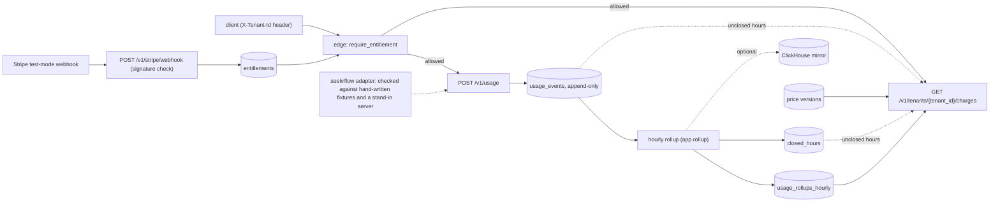

# usage-metering-service

> **What this is.** A working usage-metering and billing service, written and reviewed by AI coding sessions under a review
> harness that the operator designed and ran: briefs that fix which files a job may touch, a review desk that cannot merge,
> a merge gate that needs a review receipt, green CI and a current `main`, mutation checks and red-team lenses.
> It is a demonstration of that method, and [docs/how-it-was-built.md](docs/how-it-was-built.md) is the record of what the
> method caught. The scope is the path from a usage event to a charge; the rest is listed under [Not built](#not-built).

Usage metering and billing for AI inference traffic. Tenants report token counts per model; the service stores each event
once, totals them per hour, prices them in integer micro-USD, and gates access on a Stripe test-mode subscription.
Python 3.12, FastAPI, plain SQL through psycopg, Postgres 16. Test mode only: nothing calls Stripe.

To try it, run `scripts/up`: one command that starts the stack, plays a three-tenant scenario against a stand-in inference
server and checks the charges independently ([docs/demo.md](docs/demo.md)). The other route, `docker compose up -d --build`
then `scripts/demo.sh`, is under [Run it](#run-it); `scripts/test` runs the tests.



## How it was built

The operator designed the process that made AI-written code mergeable, and this section is the record of what that process
caught and missed. Models wrote and reviewed the code; the operator designed and ran the method around them.

The method: one brief per job that fixed which files it could touch; a review desk (DRC) that reads each change and cannot
merge; a merge command that refuses without a review receipt for the branch, a head that contains the latest `main` and
green CI; a mutation check (break the new rule by one line, watch the guarding test fail, revert); four read-only red-team
lenses (money, concurrency, security, operations), each counting a finding only with a command or a failing test that shows it; and
agents with no context who read a clean copy of the tree. Round one of the red team found 0 blockers, 9 major and 10 minor,
and round two 0 blockers reported, 3 major and 7 minor; a fifth lens that checked the README and docs against the code found
0 major and 9 minor.

Who checked it. Every reviewer was a model, except that the operator read five functions on the money and entitlement path:
`_store`, `close_hour`, `_in_force` with `_rate`, `require_entitlement` and `_apply_subscription`. The reviewers found real
defects and missed some; [docs/reviews/README.md](docs/reviews/README.md) keeps their counts.
The platform adapter (`seekrflow`) is checked against hand-written examples of its responses and the stand-in
inference server; `seekrflow live` is the command that takes a real key. `scripts/flood.py` sends 600 requests from
150 clients by default.
Details: [how it was built and checked](docs/how-it-was-built.md),
the longer [build story](docs/build-story.md) and the timestamped [build log](docs/build-log.md).

Read next: [how it works, part by part](docs/how-it-works.md), [the review reports](docs/reviews/README.md),
and [what is not built](#not-built).

## How it works

Nine parts, from an event arriving to an optional copy and the platform adapter: intake and its status codes, the append-only
log, hourly rollups, versioned prices and charges, Stripe webhooks and entitlements, the fail-closed edge, two read-only
reports, the ClickHouse copy and the adapter. Every rule and limit is in [docs/how-it-works.md](docs/how-it-works.md).

## API

| Method | Path | Success | Other answers |
|--|--|--|--|
| GET | `/healthz` | 200 `{"status": "ok"}` while the process is up (it says nothing about the database) | none; no edge check |
| POST | `/v1/usage` | 201 `{"status": "accepted", "event_id", "late"}`, or 200 `{"status": "duplicate", "event_id", "late"}` | 400, 403, 409, 413, 422, 503, 504; edge 401, 402, 503 |
| POST | `/v1/usage/batch` | 201 `{"accepted", "duplicate", "results": [{idempotency_key, status, event_id, late}]}`, or 200 when every event was already stored; all or nothing, 1 to 1000 events | 400, 403, 409, 413, 422, 503, 504; edge 401, 402, 503 |
| GET | `/v1/tenants/{tenant_id}/charges?start=&end=` | 200 `{tenant_id, start, end, lines, total_micros, line_count, next_cursor, unclosed_hours, unclosed_hours_truncated}` (`limit`, `cursor` page it: [docs/billing.md](docs/billing.md)) | 403, 409, 422, 503, 504; edge 401, 402, 503 |
| POST | `/v1/stripe/webhook` | 200 `{"status": "processed" \| "duplicate" \| "stale" \| "ignored"}` | 400, 413, 503, 504; no edge check, the signature is the check |

Any route: **404** for an unknown path and **405** for a wrong method.

## Run it

```bash
docker compose up -d --build --wait   # Postgres 16, the API on 127.0.0.1:8000 and the hourly rollup service
scripts/demo.sh                # an end-to-end run against that stack (needs curl and python3)
scripts/test                   # runs the tests against a Postgres 16 container it starts in docker
```

The API and database ports listen on 127.0.0.1 only (`API_PORT` and `DB_PORT` change them); the container runs as an
unprivileged user. If something fails while it runs, start at [docs/runbook.md](docs/runbook.md). The demo prices a
model, sends a locally signed subscription event, posts usage (with a resend), closes the hour with the rollup
and checks the charge; it ends with `demo ok`. Details: [docs/demo.md](docs/demo.md). Two things to know:
- Wait for the API before you use it. `docker compose up -d --build --wait` (and `scripts/up`) return when the api
  answers its healthcheck; a plain `up -d` returns before the api answers, so a
  run that starts too early fails: `scripts/demo.sh` prints `FAIL step 3 ... got 000`, and `scripts/flood.py` hit a
  `ConnectionResetError` on a first start. Run it again once the api answers.
- Postgres applies the files in `db/` only when its data volume is first created, so an existing
  volume (for example after an upgrade that adds a column) is not repaired by `up`. Every file in `db/` is repeatable
  and the image carries them, so apply them to the running stack
  without losing data: `docker compose exec -T api python -c "from app import db; c=db.connect(); db.apply_schema(c); print('applied')"`.
  After an interrupted first start the way back is `docker compose down -v`, then `docker compose up -d --build --wait`
  again: a first start holds no data to keep. `up --wait` can return 0 on the half-built stack, because no healthcheck
  opens the `metering` database (the db's is `pg_isready`, the api's `/healthz` checks the process only, the rollup has
  none); the signs are `scripts/demo.sh` failing in its first steps and the rollup container restarting in a loop.
  The data lives in the named volume `pgdata`, so `docker compose down` and a recreated container keep it, and only
  `docker compose down -v` resets it (it deletes it). A stack started before the volume was named keeps its old data in an
  anonymous volume: dump it with `pg_dump --data-only` before switching ([docs/demo.md](docs/demo.md)).

The compose file sets a fake `STRIPE_WEBHOOK_SECRET` (`whsec_test_...`). It sits in this public repo, so anyone who reads it could sign a webhook for a stack run as it is: never expose such a stack. Settings the code reads:
`DATABASE_URL`, `STRIPE_WEBHOOK_SECRET`, `GRACE_PERIOD_HOURS`, `LOG_LEVEL` (default `INFO`; an invalid value falls back to it), `DB_POOL_MAX` (most connections one API process borrows from its pool; default 40; a number above 0) and `DB_POOL_TIMEOUT` (seconds a request waits for a free connection before it answers 503; default 5, the connect timeout; a number above 0).
Under compose the api gets `LOG_LEVEL` from your shell and the fake `STRIPE_WEBHOOK_SECRET`; the other settings reach it through a
compose override file, which Compose reads on its own as `compose.override.yaml` beside `compose.yaml` (example values):

```yaml
services:
  api:
    environment: {GRACE_PERIOD_HOURS: "24", DB_POOL_MAX: "10", DB_POOL_TIMEOUT: "2"}
```

To test against your own database:
`DATABASE_URL=postgresql://... uv run pytest -q`. `scripts/test` starts one shared container, `metering-test-db`,
on 127.0.0.1:5455 and leaves it running; `docker rm -f metering-test-db` removes it.
How it is tested, with a burst check and a database outage check you can run on a live stack, and what is not covered: [docs/testing.md](docs/testing.md).
A reading guide to the code, file by file: [docs/code-tour.md](docs/code-tour.md).

## Not built

- Correcting drift: `app.reconcile` reports a difference and changes nothing. (`app.mirror --backfill` only re-copies the optional ClickHouse mirror.)
- ClickHouse at scale or in production: the mirror is a small optional copy (`docs/clickhouse.md`), run by hand on one local node.
- Any call to the inference platform the adapter (`seekrflow`) is written for (no key), and its per-model prices: the prices in the tests are illustrative.
- Cluster manifests, a dashboard, late adjustments and the other items listed in [docs/design-notes.md](docs/design-notes.md).
- Pushing usage to Stripe, invoices, or any call to Stripe.
- Gating inference: the edge controls recording usage and reading charges, not serving inference. `seekrflow live` calls the
  service first and posts the usage after, so an unpaid or canceled tenant still gets the completion; its usage then gets 402,
  `live` exits 1, and the usage is lost unless `--spool` was used. A real gate needs an entitlement-read endpoint, which does not exist.
- Real authentication: the tenant comes from the `X-Tenant-Id` header, which anyone can send.
- A test-mode guard: `livemode` is never read, so the service is test-mode only because the compose file sets a
  fake webhook secret.
- `invoice.paid`: paying an invoice does not restore access; only a `customer.subscription.*` event does.
- A queue or stream in front of the log: events are written straight to Postgres.
- Private deployments that cannot report to a central service.
- A query API over rollups, and an API to add prices (prices are added with `add_price_version`).
- Billing late events: they are stored and flagged, never rolled up, and no application code reopens a closed hour.
- Token columns wider than BIGINT: one tenant, model and hour that sum past 9.2e18 tokens fails that hour's close
  loudly and the hour stays unclosed (known limit in [docs/ingest.md](docs/ingest.md)).
- A database that freezes after a connection was made (a paused container) is not bounded by the timeouts, and neither
  is the first query after connecting (known limit in [docs/ingest.md](docs/ingest.md)).
- Bounding the hour of an event: it is the client's `occurred_at`, and `received_at` (stored) is not used to limit it. A client
  can date usage into an hour that is already closed (stored `late`, never billed) or far ahead (its hour cannot close until
  it has ended, so it is not charged until then). `app.reconcile` reports both under `not billed:`; nothing refuses them.
- A close per tenant: hours close for every tenant at once, so one tenant's event in an old quiet hour makes that hour close,
  and another tenant's event for the same hour that arrives afterwards is `late` (stored, never billed).
- Usage after access is cut: once the edge answers 402, a tenant cannot send usage it had not sent yet, because `/v1/usage`
  sits behind the edge; the events are refused, not stored for later.

